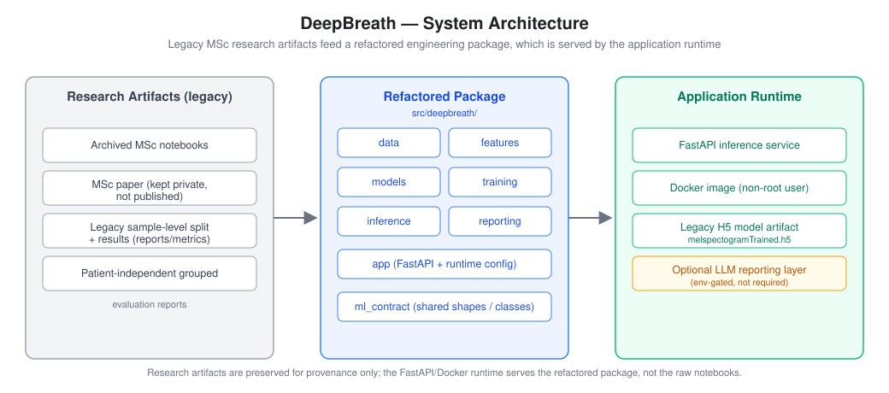
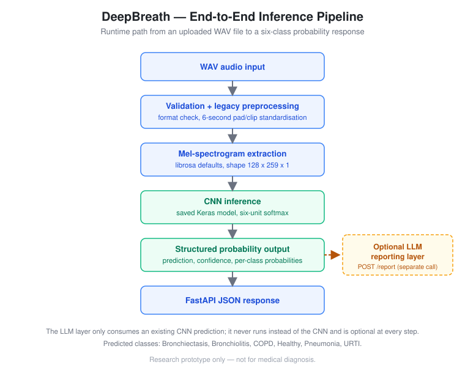
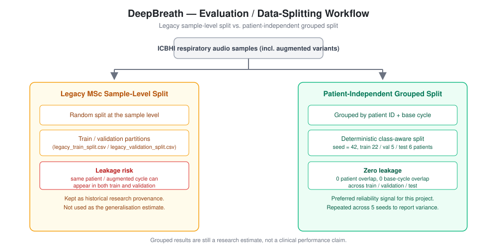
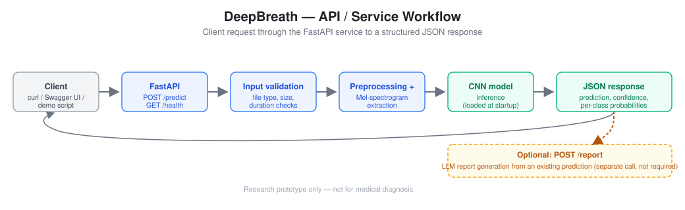

# Respiratory Audio AI Engineering Platform — DeepBreath

DeepBreath began as an MSc respiratory-sound classification study and has since been refactored into an end-to-end AI engineering project. It now includes a reproducible preprocessing/inference pipeline, patient-independent evaluation, FastAPI serving, Docker packaging, automated tests, and an optional LLM reporting layer. **DeepBreath is a research and portfolio prototype — it is not a clinical diagnosis tool.**

This repository is presented primarily as an **AI engineering / backend ML** portfolio project: the interesting engineering work is the notebook-to-package refactor, the leakage-safe evaluation pipeline, and the FastAPI/Docker service around an existing CNN — not a new model architecture and not a full-stack application.

## Overview

DeepBreath classifies respiratory audio recordings into six disease categories using a Mel-spectrogram CNN, originally trained as part of an MSc coursework project on the [ICBHI Respiratory Sound Database](https://bhichallenge.med.auth.gr/). The current repository keeps that original model and its research results intact, while adding the engineering scaffolding needed to run, evaluate, and serve it responsibly: a patient-independent evaluation path that exposes leakage in the original split, a FastAPI inference service with input validation and typed responses, Docker packaging, and a modular optional LLM layer for generating plain-language explanations of model output. Nothing here is validated for clinical use.

## Research Origin vs Current Engineering System

| | Legacy research material | Current engineered system |
|---|---|---|
| **What it is** | MSc coursework notebooks, the original CNN training run, and the original sample-level train/validation split | A refactored `src/deepbreath/` package, a leakage-safe evaluation pipeline, a FastAPI service, and Docker packaging |
| **Where it lives** | `notebooks/archive/research/` (outputs cleared, secrets/paths redacted), `reports/metrics/legacy_*.csv` | `src/deepbreath/`, `scripts/`, `tests/`, `reports/metrics/grouped_*` |
| **Status** | Preserved unchanged for provenance | Actively maintained; this is the code that runs |
| **Evaluation** | Sample-level split — patients and augmented variants can leak across train/validation | Patient-independent grouped split with zero patient/base-cycle overlap |
| **How to read it** | Historical context for where the model came from | The actual runnable, testable system |

The original MSc report PDF is kept as a private local reference only (its cover page lists student numbers) and is **not** published in this repository.

## System Architecture



```text
Research Artifacts (legacy)        Refactored Package (src/deepbreath)      Application Runtime
------------------------------     ------------------------------------    ------------------------------
Archived MSc notebooks       -->   data / features / models / training      FastAPI inference service
Legacy sample-level split          / inference / reporting / app            Docker image (non-root user)
Grouped evaluation reports         ml_contract (shared shapes/classes)      Legacy H5 model artifact
                                                                             Optional LLM reporting layer
```

Additional diagrams (research pipeline, deployment path, layer separation, and the optional LLM extension) are available as Mermaid diagrams in [docs/architecture_diagram.md](docs/architecture_diagram.md).

## End-to-End Inference Pipeline



```text
WAV upload
-> file and audio validation
-> legacy six-second preprocessing (pad/clip standardisation)
-> Mel-spectrogram extraction (128 x 259 x 1)
-> saved CNN inference (six-unit softmax)
-> structured six-class probability response
-> optional LLM reporting layer (separate call)
```

The API path is intentionally narrower than the full research pipeline: it wraps the existing saved CNN and preprocessing contract without changing model architecture, weights, or class mapping.

## Predicted Classes

The CNN is a six-class classifier with a six-unit softmax output, verified against the saved `.h5` artifact and the refactored code:

- Bronchiectasis
- Bronchiolitis
- COPD
- Healthy
- Pneumonia
- URTI

The MSc paper contains an inconsistent textual reference to an eight-neuron output layer; the archived notebooks, saved model, and refactored code all use six classes.

## Evaluation Strategy

DeepBreath reports two different evaluation views. They should not be mixed.



### Original MSc experiment (legacy)

The MSc notebooks reported strong validation performance using the original sample-level split. This result is preserved for research provenance under `reports/metrics/legacy_train_split.csv` / `legacy_validation_split.csv`.

The legacy split is **not** patient-independent: samples from the same patient, and augmented versions of the same base respiratory cycle, can appear across train and validation sets. That makes the original result useful historical context, but not a reliable estimate of deployment generalisation.

### Patient-independent grouped evaluation (current)

The refactored project adds a leakage-safe grouped evaluation path under `reports/metrics/grouped_patient_split/` and `reports/metrics/grouped_repeated_evaluation/`. The grouping key is the ICBHI patient ID parsed from the processed audio filename; augmented variants are grouped by their shared base respiratory cycle ID so they cannot cross splits.

Why leakage-safe evaluation matters: without patient-level grouping, a model can effectively memorise a specific patient's acoustic signature (present in both train and validation via augmented copies) and appear far more accurate than it would be on an unseen patient — exactly the failure mode this grouped split is designed to expose.

Grouped split summary — method: deterministic class-aware patient-level grouped split, seed `42`, patients train `22` / validation `5` / test `6`, samples train `2052` / validation `918` / test `774`, patient overlap `0`, base-cycle overlap `0`.

Grouped holdout metrics (single retrain of the original CNN architecture): accuracy `0.4535`, balanced accuracy `0.4391`, macro F1 `0.3483`, weighted F1 `0.4442`.

Repeated grouped holdout evaluation across seeds `7, 21, 42, 84, 168` shows substantial split/training variance: mean accuracy `0.3695 ± 0.0515` (range `0.2971`–`0.4148`), mean balanced accuracy `0.4157 ± 0.0874`, mean macro F1 `0.3295 ± 0.0687`, mean weighted F1 `0.3451 ± 0.0480`.

The single-run accuracy above is above the repeated deterministic holdout range and should be treated as an optimistic single-run outcome, not a stable performance estimate. The repeated grouped metrics are the preferred reliability signal for this project — they are still not medical performance claims.

Known limitation: the balanced subset has very few patients for some classes. Pneumonia has only two patients, so preserving patient isolation means Pneumonia is absent from validation and represented by one patient in test.

## API / Service Layer



Verified FastAPI endpoints (`src/deepbreath/app/api.py`):

- `GET /health` — model load status, class count, model id.
- `POST /predict` — upload a WAV file, returns prediction, confidence, and per-class probabilities.
- `POST /report` — optional; takes an existing `/predict` result plus optional patient-level features and returns an LLM-generated explanation. Returns a controlled `503` if no LLM provider is configured.

```bash
curl http://localhost:8000/health

curl -X POST http://localhost:8000/predict \
  -F "file=@path/to/audio.wav"
```

## Optional LLM Reporting Layer

The LLM reporting layer is a **separate, optional module** (`src/deepbreath/reporting/`) — it does not replace the CNN, does not run CNN inference itself, and is not required for `/predict` or `/health` to work.

```text
CNN prediction
+ structured patient-level acoustic features
-> LLM explanation layer
-> summary, interpretation, limitations, disclaimer
```

It is configured through generic OpenAI-compatible environment variables (`DEEPBREATH_LLM_API_KEY`, `DEEPBREATH_LLM_BASE_URL`, `DEEPBREATH_LLM_MODEL`). If unset, `/predict` and `/health` remain fully functional and `/report` returns a controlled configuration error instead of attempting an LLM call. LLM-generated output must not be interpreted as medical advice.

## Tech Stack

**ML / Data**
TensorFlow / Keras (CNN), librosa (audio + Mel-spectrogram extraction), soundfile, NumPy, pandas, scikit-learn (evaluation metrics).

**Backend / API**
FastAPI, Pydantic, Uvicorn, python-multipart.

**Serving / Packaging**
Docker (non-root runtime user, healthcheck, `.dockerignore`), environment-variable-based runtime configuration.

**Optional Reporting**
OpenAI-compatible client (`openai` SDK) for the modular LLM reporting layer.

**Testing**
`unittest` (29 tests covering API behaviour, ML contract, saved-model contract, preprocessing compatibility, grouped-split leakage checks, and public-notebook secret/path scanning).

## Engineering Highlights

- Refactored MSc research notebooks into an importable Python package organised by data, features, models, training, inference, reporting, and application layers.
- Standardised the runtime inference pipeline (WAV → 6s standardisation → Mel-spectrogram → CNN) into a single reusable path shared by the CLI script and the API.
- Added patient-independent grouped evaluation with a dedicated leakage test (`test_grouped_patient_split.py`) to expose and quantify the sample-level leakage risk in the original MSc split.
- Exposed the saved CNN through a FastAPI service with structured error handling, upload validation (file type, size, duration), and typed request/response models.
- Packaged the service with Docker: non-root runtime user, `HEALTHCHECK`, `.dockerignore`, and environment-based configuration — verified to build and run natively on Apple Silicon (`linux/arm64`, TensorFlow `2.21.0`).
- Preserved compatibility with the legacy `melspectogramTrained.h5` artifact (including its original misspelling) while using corrected `melspectrogram` naming throughout the new code.
- Kept the optional LLM reporting layer fully decoupled from the core `/predict` path so narrative generation never affects CNN inference.
- Added a dedicated public-security test that scans the published notebooks for known secret/path patterns before they can be committed.

## Repository Structure

```text
src/deepbreath/
  data/        ICBHI loading, segmentation, augmentation, labels, grouped splits
  features/    Mel-spectrogram extraction and shape validation
  models/      CNN architecture and saved model loading
  training/    Legacy and grouped evaluation training helpers
  inference/   Single-audio prediction pipeline
  reporting/   Patient-level aggregation and LLM prompt/client modules
  app/         FastAPI inference service and runtime configuration

notebooks/archive/research/  Cleaned MSc notebook artifacts (outputs cleared)
docs/                        Architecture notes, model card, safety docs, diagrams
models/                      Lightweight saved CNN artifact
data/metadata_sample/        Small metadata examples for reproducible checks
reports/metrics/             Legacy and grouped evaluation outputs
scripts/                     CLI entrypoints (train, evaluate, predict, demo)
tests/                       Contract, preprocessing, inference, evaluation, and API tests
```

Large raw audio folders and generated feature caches are intentionally not committed.

## Local Setup

```bash
python -m pip install -r requirements.txt
python -m pip install -e .
```

## Running the API Service

```bash
uvicorn deepbreath.app.api:app --host 0.0.0.0 --port 8000
```

Or with Docker:

```bash
docker build -t deepbreath .
docker run -p 8000:8000 deepbreath
```

Optional LLM reporting in Docker:

```bash
docker run -p 8000:8000 \
  -e DEEPBREATH_LLM_API_KEY=your-provider-key \
  -e DEEPBREATH_LLM_BASE_URL=https://api.example.com/v1 \
  -e DEEPBREATH_LLM_MODEL=provider-model-name \
  deepbreath
```

## Example Usage

Open Swagger UI at `http://localhost:8000/docs`, expand `POST /predict`, upload a `.wav` file, and execute.

```bash
curl -X POST http://localhost:8000/predict \
  -F "file=@path/to/audio.wav"

python scripts/predict_audio.py \
  --model models/melspectogramTrained.h5 \
  --audio path/to/audio.wav

python scripts/demo_predict.py path/to/audio.wav
```

Example response shape (also saved at [docs/examples/example_prediction.json](docs/examples/example_prediction.json)):

```json
{
  "prediction": "URTI",
  "confidence": 0.84,
  "probabilities": {
    "Bronchiectasis": 0.01,
    "Bronchiolitis": 0.08,
    "COPD": 0.02,
    "Healthy": 0.03,
    "Pneumonia": 0.02,
    "URTI": 0.84
  },
  "model": "deepbreath_legacy_cnn",
  "disclaimer": "Research prototype only. Not for medical diagnosis."
}
```

More demo guidance is available in [docs/demo.md](docs/demo.md) and [docs/demo_screenshots.md](docs/demo_screenshots.md).

## Tests / Validation

```bash
python -m unittest discover -s tests -v
```

29 tests currently pass, covering: API request/response behaviour, the shared ML contract, saved-model contract shape checks, legacy preprocessing compatibility, grouped-split leakage guarantees, LLM configuration handling, structured report generation, and a public-security scan of the published notebooks for known secret/path patterns.

## Limitations

- The refactored grouped-evaluation accuracy (~0.37–0.45 depending on seed) is modest and highly seed-dependent — this is an honest research result, not a production-ready classifier.
- Several classes (notably Pneumonia and COPD) have very few distinct patients in the balanced dataset, which limits how much the grouped evaluation can be trusted.
- The model has not been externally validated on any dataset beyond ICBHI.
- The service is a single-process local/Docker deployment; it has no authentication, autoscaling, or production monitoring.
- The LLM reporting layer's quality depends on prompt design and the configured provider; it has not been systematically evaluated for factual accuracy.

## Clinical Safety / Non-Diagnostic Use

DeepBreath is a research and portfolio prototype. It is not a medical device and must not be used as a standalone diagnostic system. Predictions and LLM-generated reports should be treated as engineering demonstrations grounded in available model outputs and metadata, not as clinical advice. See [docs/clinical_safety.md](docs/clinical_safety.md) for the full safety notes.

## Future Improvements

- Export the legacy `.h5` artifact to the modern `.keras` format alongside its training configuration.
- Expand grouped-evaluation patient counts for underrepresented classes (Pneumonia, COPD).
- Add CI (lint, tests, Docker build) on push.
- Systematically evaluate the LLM reporting layer's factual accuracy against structured model output.

## Model Artifact

The original saved model is preserved as `models/melspectogramTrained.h5`. The filename contains the original `melspectogram` misspelling, intentionally retained for research provenance; new code uses the corrected `melspectrogram` spelling for modules and functions while still supporting the legacy artifact name.

## Additional Documentation

- [docs/architecture.md](docs/architecture.md) — ML contract and runtime notes.
- [docs/architecture_diagram.md](docs/architecture_diagram.md) — Mermaid diagrams for the research pipeline, deployment path, and LLM extension.
- [docs/model_card.md](docs/model_card.md) — model card with intended use and known limitations.
- [docs/research_summary.md](docs/research_summary.md) — summary of the original MSc research scope.
- [docs/publication_safety.md](docs/publication_safety.md) — what was and was not published, and why.
