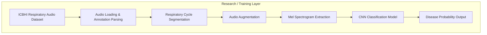
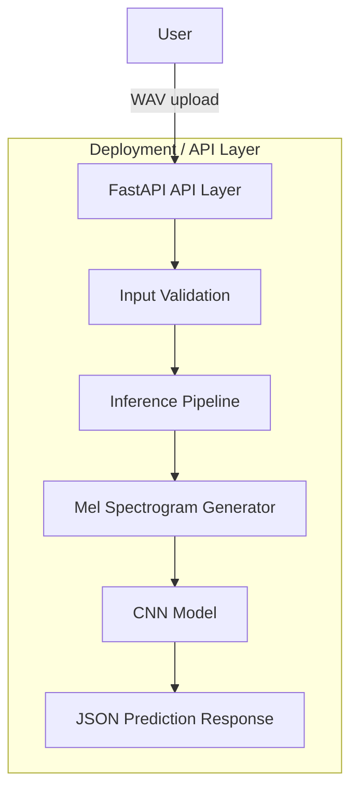
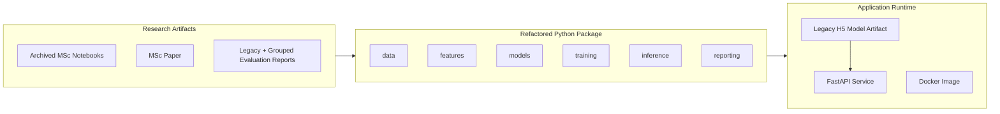
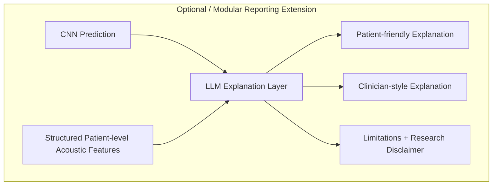

# DeepBreath Architecture Diagrams

These diagrams describe the research and application architecture of DeepBreath.
They are intended for portfolio documentation and do not imply clinical
deployment or diagnostic validation.

## Research Pipeline

This diagram shows the original respiratory audio machine learning workflow:
dataset ingestion, cycle-level preprocessing, Mel-spectrogram feature
generation, and CNN probability prediction.

## Deployment Inference Service

This diagram shows the application-layer inference path exposed by FastAPI.
The service wraps the existing saved CNN model and preprocessing pipeline; it
does not alter the model architecture, weights, class mapping, or evaluation
results.

## Current Layer Separation

DeepBreath separates the research pipeline from the deployable inference
service. This keeps the original MSc experiment auditable while allowing the
saved model to be served through a production-style API boundary.

## Future LLM Reporting Extension

The LLM reporting layer is an optional extension for AI-assisted explanation.
It is separate from the `/predict` endpoint and should not be treated as
clinical functionality or diagnosis.

## Safety Boundary

- The FastAPI service returns model probabilities for research demonstration.
- The grouped evaluation is a more conservative generalisation estimate than
  the original sample-level MSc split.
- The system is not clinically validated and must not be used for diagnosis.
